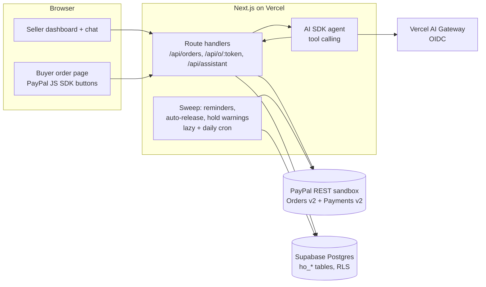
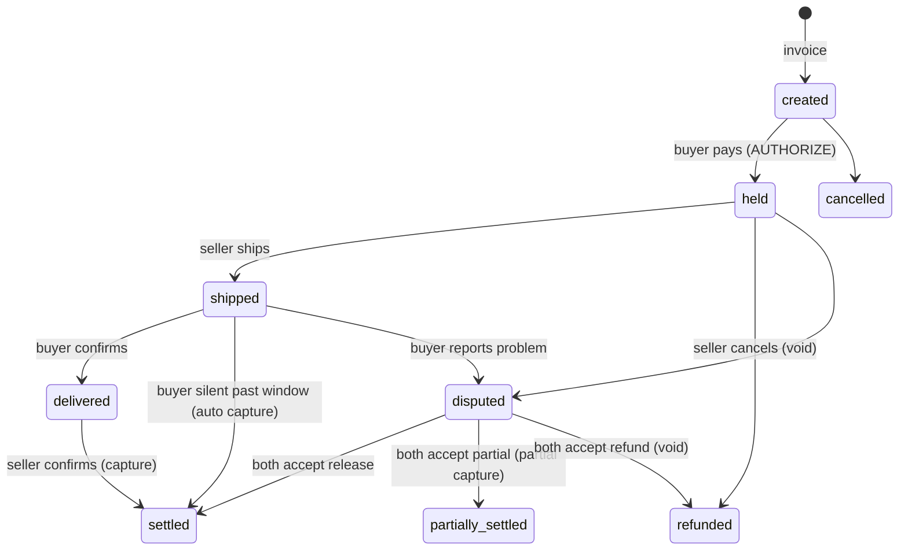

# Handover

**Get paid upfront. Release on delivery.**

Handover is an AI money assistant for small sellers and their buyers. A seller types *"Invoice Ada $50 for 2 cakes, delivery Friday"*, the buyer pays with PayPal, and the money is **held (authorized, not captured)**. It only clears once the goods arrive safely **and both the buyer and the seller confirm**. If something goes wrong, an AI mediator reads both sides and the photos and proposes a fair outcome, and nothing moves until both accept.

Built for the **PayPal AI Hackathon 2026** (Devpost). Free to build, free to use, PayPal sandbox only.

- **Live app:** https://handover-pay.vercel.app
- **Judge quick start:** https://handover-pay.vercel.app/judges

---

## Why

Most small online sellers, especially Instagram/WhatsApp sellers and sellers outside the US, live with a trust problem. Buyers don't want to pay a stranger upfront, and sellers don't want to bake, sew or ship before they're paid. Handover uses PayPal's **authorize now, capture later** flow so both sides are protected, and puts an AI assistant in front of it so a seller can run the money side of their shop from a chat.

## Judge quick start

1. Open **https://handover-pay.vercel.app/login?demo=1**. You're logged in to the seeded demo shop (or sign in with handle `demo`, passcode `demo1234`). It has 10 orders in every state.
2. **Assistant**: type `Invoice Ada $50 for 2 cakes, delivery Friday`. You get a new order and a buyer link.
3. **Be the buyer**: open the buyer link in another tab (no login needed) and pay.
   - *PayPal sandbox connected:* use the PayPal button with a **sandbox personal account** (create one at developer.paypal.com → Testing tools → Sandbox accounts). The payment is **authorized, not captured**.
   - *Sandbox not connected (current default):* click **PayPal DEMO** and approve. It's labelled "Demo payment, PayPal sandbox not connected" and uses a simulated authorization ID.
4. **Ship**: as the seller, add carrier/tracking or a photo and click **Mark shipped**, or tell the assistant `mark order 11 shipped DHL 1234567890`.
5. **Confirm both sides**: buyer clicks **Received, all good**; seller clicks **Confirm delivered**. The authorization is captured and the order is **Settled**.
6. **Dispute**: on another order, as the buyer, click **Report a problem** (photo optional). The AI mediator proposes release / partial / refund. Accept on both sides to execute it (void, partial capture or full capture). Order **#9** is already in dispute.
7. **Auto-release**: on shipped order **#7**, open *Demo controls* → **Simulate buyer silence**. It captures automatically.
8. **Hold age**: order **#6** has a 3.5-day-old authorization. See the honor-period warning and click **Reauthorize**.
9. Also: AI weekly summary + totals on the dashboard, risk flags (order **#10**), notifications log, auto-release window in Settings, **Reset demo data** in Settings.

## Features

| Area | What it does |
| --- | --- |
| Chat assistant | Natural-language commands with tool calling on the seller's real data: create invoice, who hasn't paid, show held money, remind a buyer, mark order shipped, confirm delivered, order details, draft a dispute reply, weekly summary |
| Invoices | One-sentence invoice parser (AI, with a deterministic fallback) + editable form, shareable buyer link per order |
| Held payments | PayPal Orders v2 `intent: AUTHORIZE`; funds reserved on the buyer's account until release |
| Two-sided release | Capture only after **buyer confirms receipt and seller confirms handover** |
| Disputes | Buyer reports a problem with a photo; AI mediator reads messages, evidence and photos (vision) and proposes release / partial / refund; counter-offers; executes only when both accept (void, partial capture, full capture) |
| Auto-release | If the seller shipped and the buyer stays silent past the window (default 48h, configurable), capture automatically. Reminders at 50% and 85% of the window |
| Hold health | Tracks authorization age: 3-day honor period, 29-day validity, warnings and one-click reauthorize |
| Risk flags | Very high amounts, unusual size vs your history, new buyer, disposable email, name/email mismatch, total mismatch, velocity, past disputes |
| Dashboard | Held vs settled vs unpaid totals, needs-attention queue, who hasn't paid, recent orders, AI weekly business summary |
| Order timeline | Created → Paid & held → Shipped → Delivered → Settled / Refunded / In dispute, plus a full activity log |
| Buyer page | Pay, track, message the seller, confirm delivery, raise a problem with a photo, accept/reject proposals |
| Notifications | In-app log of every event, unread badge |
| Demo mode | Seeded demo shop, demo payments when PayPal keys are missing, time-travel controls, reset |

## Architecture





## PayPal APIs used

| Step | API |
| --- | --- |
| Buyer pays | `POST /v2/checkout/orders` with `intent: "AUTHORIZE"` (from the JS SDK `createOrder`) |
| Place the hold | `POST /v2/checkout/orders/{id}/authorize` (from `onApprove`) |
| Release (full or partial) | `POST /v2/payments/authorizations/{id}/capture` with optional `amount`, `final_capture: true` |
| Refund before capture | `POST /v2/payments/authorizations/{id}/void` |
| Keep the hold alive | `POST /v2/payments/authorizations/{id}/reauthorize` (after the 3-day honor period, up to 29 days) |
| Auth | `POST /v1/oauth2/token` (client credentials) |

All code is in [`src/lib/paypal.ts`](src/lib/paypal.ts). When `PAYPAL_CLIENT_ID` / `PAYPAL_CLIENT_SECRET` are not set, the app runs in **demo payment mode**: the buyer sees a clearly labelled simulated PayPal approval, authorization/capture/void/partial-capture are simulated with `SIM-` IDs, and a banner says "Demo payment, PayPal sandbox not connected". Setting the env vars switches to the real sandbox automatically; nothing else changes.

**Where the PayPal Agent Toolkit fits:** the assistant's tools are plain AI SDK tools over our own order data plus the payment calls above. The next step is adding [`@paypal/agent-toolkit`](https://github.com/paypal/agent-toolkit) tools (invoices, shipment tracking, disputes) to the same agent so it can, for example, push tracking to PayPal and answer real PayPal disputes.

**Sandbox note:** in this build all holds settle to the platform's sandbox business account. Routing money to each seller's own PayPal account needs PayPal's multiparty/marketplace onboarding (with delayed disbursement for longer holds); the `paypal_email` setting is there for that.

## AI usage

All model calls use the **Vercel AI SDK** through **Vercel AI Gateway** (OIDC on Vercel, default model `spacexai/grok-4.1-fast-non-reasoning`, override with `AI_GATEWAY_MODEL`). Every AI feature has a deterministic fallback, so the app works with no model at all.

| Feature | AI | Fallback |
| --- | --- | --- |
| Invoice parsing | `generateText` + `Output.object` (zod schema) | Rule parser for names, amounts/currencies, "each" pricing, items, relative dates |
| Assistant | `generateText` with 10 tools, multi-step (`stopWhen: isStepCount(6)`) | Intent router calling the same operations |
| Dispute mediator | Structured output; reads messages, evidence and up to 3 photos (vision) | Keyword rules (not received / damaged / "1 of 2" / late) |
| Dispute reply draft, weekly summary | `generateText` | Templates from computed facts |

## Tech

Next.js 16 (App Router) + Tailwind v4 on Vercel · Supabase Postgres via PostgREST · Vercel AI SDK 7 + AI Gateway · PayPal REST sandbox + JS SDK. All free tiers.

Data lives in five tables (`ho_sellers`, `ho_orders`, `ho_order_events`, `ho_messages`, `ho_evidence`), schema in [`supabase/schema.sql`](supabase/schema.sql). Server code talks to PostgREST with the publishable key plus a secret `x-handover-key` header, and RLS rejects any request without it, so the browser never touches the database directly. Photos are resized in the browser and stored as small JPEG data URLs.

## Environment variables

| Name | Required | Where |
| --- | --- | --- |
| `SUPABASE_URL` | yes | Supabase project URL |
| `SUPABASE_ANON_KEY` | yes | Supabase publishable (anon) key |
| `HANDOVER_DB_KEY` | yes | Random secret, must match the value in `ho_ok()` from `schema.sql` |
| `SESSION_SECRET` | yes | Random secret for seller session cookies |
| `PAYPAL_CLIENT_ID` | for real sandbox | developer.paypal.com → Apps & Credentials → Sandbox app |
| `PAYPAL_CLIENT_SECRET` | for real sandbox | same app |
| `PAYPAL_API_BASE` | no | defaults to `https://api-m.sandbox.paypal.com` |
| `AI_GATEWAY_API_KEY` | local only | not needed on Vercel (OIDC) |
| `AI_GATEWAY_MODEL` | no | any `provider/model` from `https://ai-gateway.vercel.sh/v1/models` |
| `CRON_SECRET` | recommended | protects `/api/cron/sweep` |

On Vercel: Project → Settings → Environment Variables, then redeploy.

## Run locally

```bash
git clone https://github.com/Benito3262/handover && cd handover
npm install
cp .env.example .env.local   # fill in Supabase + secrets
# run supabase/schema.sql in the Supabase SQL editor after replacing __HANDOVER_DB_KEY__
npm run dev                   # http://localhost:3000, click "Try the demo"
```

## Roadmap

- PayPal multiparty onboarding so each seller is paid directly, with delayed disbursement for long deliveries
- PayPal Agent Toolkit tools in the assistant (tracking push, real dispute answers, invoices)
- WhatsApp / Telegram front-end for the same assistant
- Email/SMS notifications (free tiers)
- Courier tracking webhooks to auto-confirm shipping

## License

MIT
